<picture>
  <source media="(prefers-color-scheme: dark)" srcset="./assets/departures-board-dark.svg">
  
</picture>

<b>Aalap Biswas</b> · Student , HIT BTech CSE | Problem Solver | Tackling data structures, dynamic programming, and complex algorithmic challenges in Java.

   

**Itinerary.** **B.Tech CSE | Java & Algorithms | Hardware Tinkerer**

I enjoy building things, experimenting with technology, and figuring out how stuff works—from tackling data structures and dynamic programming in **Java** to assembling custom electronics. I learn by building, breaking things, and making them work better. Always curious, always experimenting.

**Now boarding:** working on esp32 projects and learning cyber security

#### Timetable

<picture>
  <source media="(prefers-color-scheme: dark)" srcset="./assets/departures-timetable-dark.svg">
  
</picture>

Reading the board

- **Departures** are featured repositories. Flight numbers come from your initials, **via** is the main language, and **stars** are the stars.
- **Now boarding** is what you are working on now.
- **The timetable** is the average number of contributions on each day of the week over the last twelve months; the amber row is the busiest day. On the right is the year in numbers.

Artwork: original animated SVG, generated by README Templates · template: Departures. Motion stops if your system asks for reduced motion.

#### Departures

- `AB101` **[Scuba-cat-keyring-using-oled-esp32](https://github.com/aalap-d/Scuba-cat-keyring-using-oled-esp32)**  
  C · ★ 5
- `AB102` **[ESP32-C3-OLED-Controller](https://github.com/aalap-d/ESP32-C3-OLED-Controller)** · ESP32-C3 SuperMini projects for controlling an SH1106 OLED over Wi-Fi, including video, text, and drawing.  
  C++ · ★ 4
- `AB103` **[simple-webchat](https://github.com/aalap-d/simple-webchat)**  
  Java · ★ 4
- `AB104` **[f1-strategy-optimizer](https://github.com/aalap-d/f1-strategy-optimizer)**  
  Python · ★ 4

<picture>
  <source media="(prefers-color-scheme: dark)" srcset="./assets/departures-final-dark.svg">
  
</picture>

